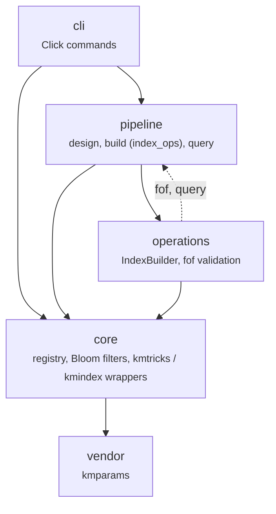

# API Reference

This section documents the public Python API of `pykmhelpers`. For a guided
example, see the [Python API tutorial](../tutorials/ecoli_api.md).

| Sub-package | Description |
|---|---|
| `pykmhelpers.core` | Core data structures and utilities |
| `pykmhelpers.pipeline` | High-level pipeline operations |
| `pykmhelpers.operations` | Low-level index/compression operations |

## Architecture

The package is organised in layers. The `cli` commands are thin: they parse
options and call `pipeline` (or `core` directly). `core` wraps the external
tools (kmtricks, kmindex) and holds the data structures.

The dashed arrow is a back-dependency: `operations/__init__.py` re-exports
`pipeline.fof.FofManager` and `pipeline.query.KmindexQuery`.

### Commands and the modules they use

| Command | Modules |
|---|---|
| `list` | `pipeline.sample_lister` |
| `profile` | `pipeline.span_profiler` |
| `compose` | `pipeline.composer` |
| `design` | `pipeline.sample_lister`, `pipeline.span_profiler`, `pipeline.composer` |
| `plan` | `pipeline.index_ops` (`IndexOps`, `cluster`, `status`) |
| `apply` | `pipeline.index_ops` (`runner`, `status`, `progress`) |
| `build` | `plan` then `apply` |
| `query` | `pipeline.query` (`QueryRunner`), `core.index` (`KmindexRegistry`) |
| `compress`, `manage` | `core.index` (`KmindexRegistry`) |

The build side is detailed in [index_ops](pipeline/index_ops.md), including
the SLURM cluster file and how to add a job kind. For what a build does from
the user's side, see [How an index is built](../concepts/building.md).
