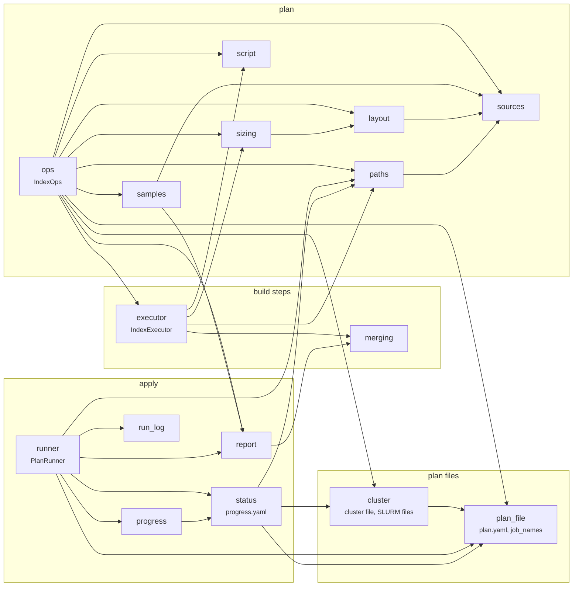
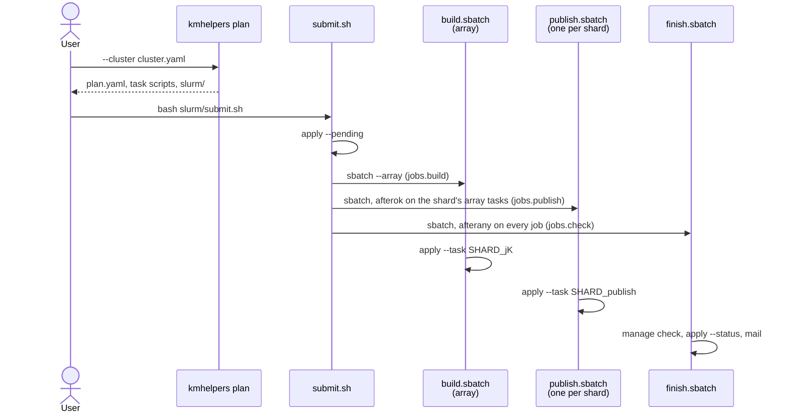

# index_ops

::: pykmhelpers.pipeline.index_ops

## Module map

`kmhelpers plan` calls `IndexOps` (`ops`), which writes a plan; `kmhelpers apply`
runs it with `PlanRunner` (`runner`). The arrows are imports.



`types` (`IndexOpsConfig`, `ApplyResult`, …) is shared by most modules and
left out of the diagram.

## A build on a cluster

With `plan --cluster FILE`, `cluster.write_slurm` writes
`BUILD_DIR/assets/<session>/slurm/` next to the plan. `submit.sh` submits
what `apply --pending` lists; every job runs `apply --task <job>`.



A shard whose chunks fit in one job (see `plan_file.job_names`) has no
separate publish job: its single job runs its chunks then its publish step in
the build array, with the `build` resources.

## Cluster file and job kinds

The cluster file (`plan --cluster`) sets the resources of each **job kind**.
`cluster.load_cluster` resolves each kind from:

1. the top-level keys (`partition`, `time`, `exclude`, `account`, `qos`,
   `constraint`, `cpus`, `mem`, `extra`), defaults for every kind;
2. `jobs.<kind>`, which overrides them;
3. for `check` only, `CHECK_DEFAULTS` (1 CPU, 4G) under `jobs.check`.

`build` and `publish` must end up with `cpus` and `mem`. An unknown kind
under `jobs` is an error.

| Kind | Script | Sizes the plan |
|---|---|---|
| `build` | `build.sbatch` (array, one task per build job) | yes: `limits_for(cluster, "build")` in `cli/plan.py` |
| `publish` | `publish.sbatch` (one per split shard) | yes: `limits_for(cluster, "publish")` |
| `check` | `finish.sbatch` | no |

For example, to send the publish and finish jobs to other partitions:

```yaml
partition: long                 # every kind
jobs:
  build:   {cpus: 24, mem: 120G}
  publish: {cpus: 24, mem: 120G, partition: bigmem}
  check:   {cpus: 1, mem: 4G, time: "1:00:00", partition: short}
```

The `#SBATCH` lines are written by `plan`, so run `plan` again after editing the
cluster file. For a one-off change, an option on the command line wins over the
script's: `sbatch -p bigmem slurm/publish.sbatch <shard>_publish`.

### Adding a job kind

A kind is only a resource profile; it does nothing until a script uses it. In
`cluster.py`:

1. Add it to `JOB_KINDS`. If it should not require `cpus` and `mem`, give it
   defaults as `check` has (`CHECK_DEFAULTS`, applied in `load_cluster`).
2. Write its script in `write_slurm`: an entry of `files` built from
   `_sbatch_lines(cluster["jobs"]["<kind>"], ...)`, `body_head` and its command.
3. Submit it in `_submit_script`: `sbatch` with its dependencies, a line in
   `submitted.tsv`, and its id in `ALL` so that `finish` waits for it. If it
   must not be submitted twice, check `active` as `finish` does.
4. If its jobs size themselves from `--limits`, pass
   `limits_for(cluster, "<kind>", safety_margin)` to the plan in `cli/plan.py`.
5. If it runs a new step of the plan (as `publish` runs `PUBLISH`), the plan
   must name it too: `plan_file.job_names` and the steps `runner.PlanRunner`
   runs. A kind that wraps an existing command (e.g. `kmhelpers manage ...`)
   only changes `cluster.py`.
6. Update the docstring of `cluster.py`, this page, and `tests/test_cluster.py`.

## Reference

### ops

::: pykmhelpers.pipeline.index_ops.ops

### plan_file

::: pykmhelpers.pipeline.index_ops.plan_file

### cluster

::: pykmhelpers.pipeline.index_ops.cluster

### runner

::: pykmhelpers.pipeline.index_ops.runner

### status

::: pykmhelpers.pipeline.index_ops.status

### progress

::: pykmhelpers.pipeline.index_ops.progress

### merging

::: pykmhelpers.pipeline.index_ops.merging

### report

::: pykmhelpers.pipeline.index_ops.report

### run_log

::: pykmhelpers.pipeline.index_ops.run_log
