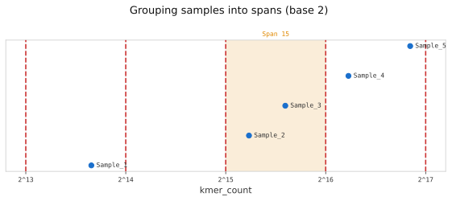

# profile

## Synopsis

Analyse a JSONL sample manifest produced by `list` and produce a Bloom-filter span profile.

!!! abstract "USAGE"
    ```
    kmhelpers profile [OPTIONS] LIST_OUTPUT
    ```

    | Argument | Description |
    |----------|-------------|
    | `LIST_OUTPUT` | JSONL sample manifest produced by `list` (required) |
    | `-o, --output DIR` | Output directory for results (required) |
    | `-g, --group N` | Partition Bloom Filters into `N` storage-balanced groups and overlay on plot; 0 chooses `N` (default: 0), see [profile - Grouping](#description) |
    | `-b, --base FLOAT` | Base for span bucket boundaries (default: 1.1); use values like 1.1 or 2.0 to widen or narrow bucket granularity |

!!! abstract "I/O"
    **Input:** JSONL sample manifest produced by `list`  
    **Output:** `profile.yaml`, `groups.png` in output directory (`-o`)

## Advanced Options

| Option | Description |
|--------|-------------|
| `--fp, --false-positive-rate FLOAT` | Target Bloom-filter false-positive rate (default: 0.25) |
| `--auto-group-samples N` | With `-g 0`: start from one group per `N` samples (default: 1000, env: `KMHELPERS_AUTO_GROUP_SAMPLES`) |
| `--auto-group-max N` | With `-g 0`: at most `N` groups (default: 20, env: `KMHELPERS_AUTO_GROUP_MAX`) |
| `--auto-group-min-gain F` | With `-g 0`: storage fraction a further group must save to be added (default: 0.2, env: `KMHELPERS_AUTO_GROUP_MIN_GAIN`) |

## Output Files

| File | Description |
|------|-------------|
| `profile.yaml` | Natural distribution and storage-balanced grouped profile(s) |
| `groups.png` | Span combination analysis plots |

## Description

A *span* is an integer `s = floor(log_base(n))`, where `n` is the number of distinct
$k$-mers in a sample and `base` controls bucket granularity (default: 2). It identifies
the Bloom-filter size class required to index that sample at the target false-positive
rate.



The figure above illustrates span assignment for five samples: each sample is placed on
the k-mer count axis and falls into the bucket delimited by consecutive powers of the
base. Here, samples whose k-mer count falls between $2^{15}$ and $2^{16}$ are assigned
to **Span 15**.

A *span profile* is the distribution of samples across spans, together with candidate
groupings of those spans into sub-indices. Fewer spans means fewer index files opened
at query time, which improves query performance on I/O-bound storage.

`profile` reads $k$-mer counts from a JSONL file produced by [`list`](list.md), assigns
each sample to its span, and writes a CSV summary, a profile YAML, and a distribution
plot to the output directory. Samples without a `kmer_count` field are skipped.

**False-positive rate** - a higher rate reduces Bloom-filter size and therefore disk
footprint. At query time the [findere](https://doi.org/10.1007/978-3-030-86692-1_13)
algorithm compensates by querying $(k+z)$-mers, reducing the effective FP rate to $p^z$.
Recommended: build with `--fp 0.25` (default), query with `-z 6`, giving
$0.25^6 \approx 0.024\,\%$ effective FP rate.

**Grouping** - use `-g N` to merge spans into `N` storage-balanced sub-indices. Fewer
sub-indices reduce the number of partition files opened per query. The grouping is
overlaid on the distribution plot for visual inspection.

With `-g 0` (default), `profile` chooses `N`:

1. it starts from one group per 1000 samples (at least 1), so a group holds at most about
   1000 samples;
2. it then adds one group at a time while the new group reduces the total storage by at
   least 20%, and stops at the first one that does not;
3. it never goes above 20 groups, nor above the number of spans.

Each group is one more sub-index to build, query and update, so a narrow distribution keeps
few groups whatever its size. For example, 169 samples whose k-mer counts spread over two
orders of magnitude start from 1 group (1.6 GB); a 2nd one saves 42% (0.95 GB), a 3rd only 18%,
so they get 2 groups.

**Sizes** - the sizes in `profile.yaml` (`disk_usage`, `total_size`, `bytes_per_sample`)
are for a presence/absence index, 1 bit per sample and Bloom-filter cell. An abundance
index (`design`/`compose --ab N`) stores N bits per cell: multiply them by N, e.g. 208 MB
becomes 624 MB with `--ab 3`. The factor is the same for every group, so it does not change
the grouping chosen; `compose` counts it in its own estimates.

`--auto-group-samples`, `--auto-group-max` and `--auto-group-min-gain` (or their
`KMHELPERS_AUTO_GROUP_*` environment variables) change these values. The chosen count is
logged (`Auto groups: N (… start …, max …, min gain …)`), and recorded with the values used
under `auto_group` in `profile.yaml`.

## Examples

```bash
# Profile with default settings
kmhelpers profile samples.jsonl -o ./profile_output

# Use a stricter false-positive rate
kmhelpers profile samples.jsonl -o ./profile_output --fp 0.05

# Let profile choose the number of span groups (default)
kmhelpers profile samples.jsonl -o ./profile_output -g 0

# Force a specific number of span groups
kmhelpers profile samples.jsonl -o ./profile_output -g 3

# Use a finer bucket granularity
kmhelpers profile samples.jsonl -o ./profile_output -b 1.5
```

## See Also

- [`list`](list.md) - produce the JSONL input file
- [`compose`](compose.md) - use the JSONL from `list` and a profile to compose index definitions
- [Choosing Groups and Partitions](../concepts/tuning-groups-partitions.md) - how `-g` affects query time, RAM, and storage