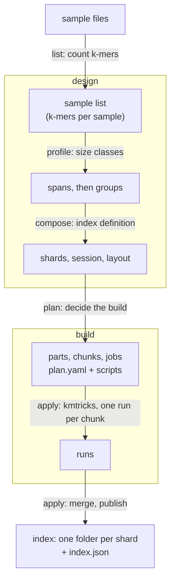
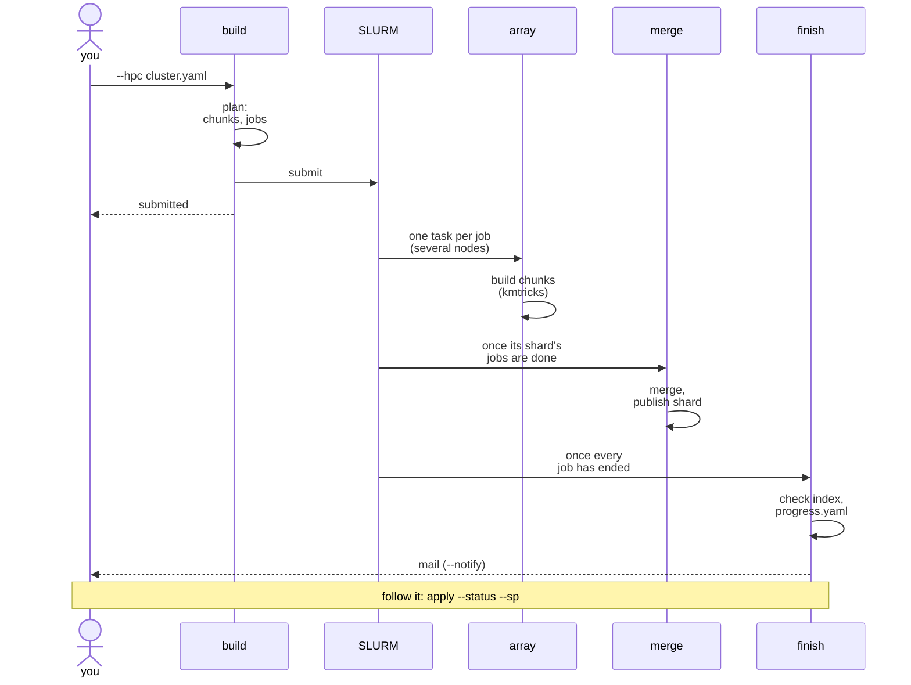
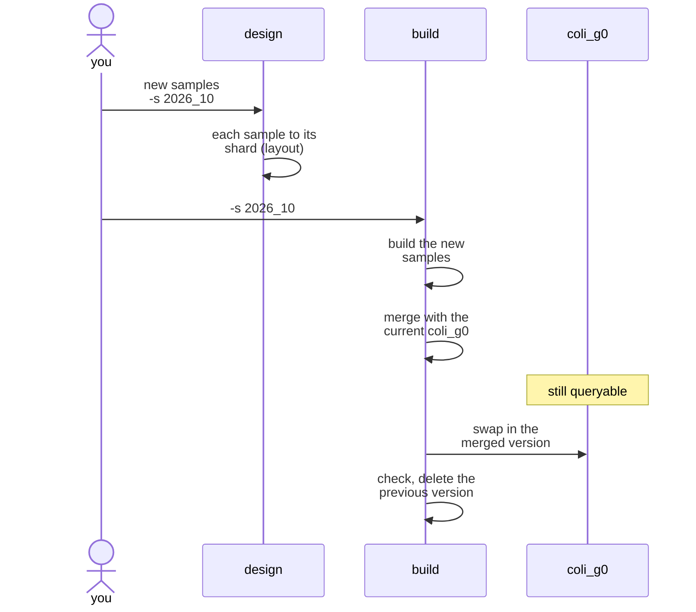

# How an index is built

## From sample files to an index

[`design`](../commands/design.md) decides how the index is organized, from the sizes of the
samples; [`build`](../commands/build.md) decides how to build it on this machine (or a
cluster), then builds it. `design` runs three commands and `build` two, which can also be
run one by one (see the [step-by-step tutorial](../tutorials/ecoli_steps.md)).

1. **list** counts the k-mers of each sample ([K-mer counting](kmer-counting.md)).
2. **profile** sorts the samples into spans by k-mer count, then merges consecutive spans
   into groups, balancing storage ([profile](../commands/profile.md#description)).
3. **compose** writes the index definition: the shards of each group, the samples this
   session adds to each shard, and the layout, kept for later updates.
4. **plan** takes every build decision from the resources available: partitions, threads,
   whether a part is built in one run or in chunks, how chunks are merged, and the jobs.
   It builds nothing ([plan](../commands/plan.md)).
5. **apply** runs the plan: each chunk is one kmtricks run; the runs of a shard are merged,
   then published into the index, and checked ([apply](../commands/apply.md)).

## Why shards and chunks

Both cut the samples into smaller sets, for different reasons:

| | Shard | Chunk |
|---|-------|-------|
| what | a slice of a group, kept in the index | a slice of the samples of one build, merged afterwards |
| why | keep each index of the samples bounded, as the index grows | fit one kmtricks run in the open-files and memory limits of a machine |
| decided by | `design` (`--sb`), once for the life of the index | `plan` (`--cb`, the resources), at each build |
| visible in the index | yes: one folder per shard | no: only its shard is |

See [compose - Sharding](../commands/compose.md#description) and
[build - Shards and chunks](../commands/build.md#shards-and-chunks).

## On a cluster

With `--hpc cluster.yaml`, `plan` sizes the build for the jobs of a SLURM cluster, and the
jobs run the plan: chunks on several nodes at once, then one merge per shard. See
[build - On a cluster](../commands/build.md#on-a-cluster).

A failed job cancels the jobs waiting on it, and the finish job reports it; running the same
`build` command again submits only what is not done.

## Updating an index

An update is a new session, under a name of your choice (`-s 2026_10`, `-s batch2`...; the
tutorial uses `update`): its samples are added to the shards of the existing layout, so
that the index keeps its groups, Bloom filter sizes and partitions.

The swap takes a second or so; until then, queries see the previous version. An
interrupted update is finished by running the same command again. See
[build - Updating an index](../commands/build.md#updating-an-index) and the
[update tutorial](../tutorials/ecoli_update.md).
