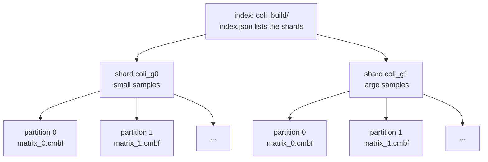
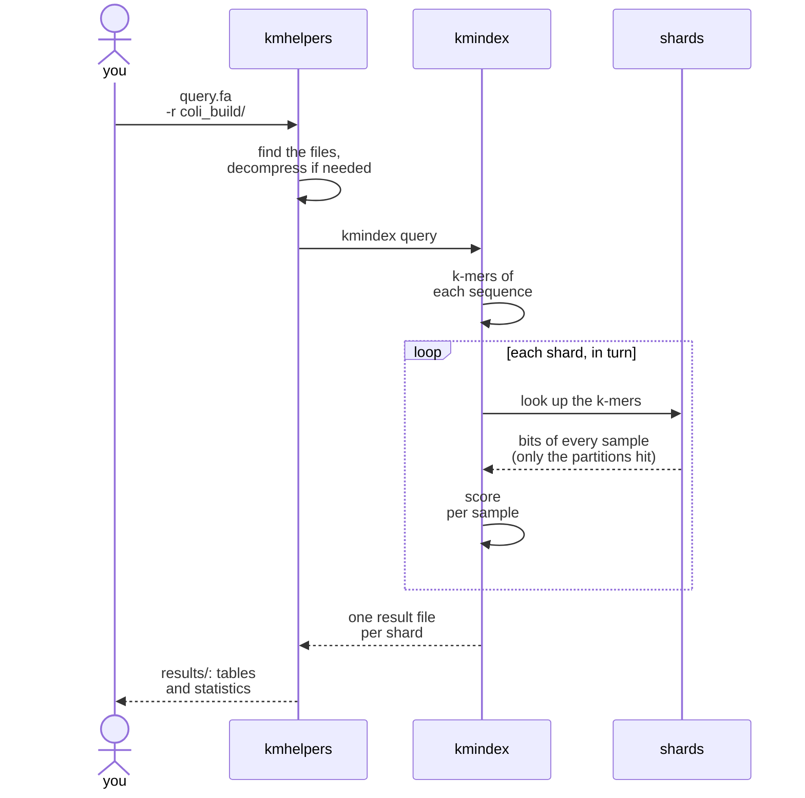

# How an index is structured

## What an index answers

For each k-mer of a query, an index tells which samples contain it. A query sequence gets
one **score** per sample: the fraction of its k-mers found in that sample (1 when they all
are). An abundance index (`design --ab N`) also stores how often each k-mer occurs, as a
class from 0 to 2^N - 1, and reports that class instead.

Each sample is stored as a [Bloom filter](https://en.wikipedia.org/wiki/Bloom_filter): a
compact bit array that can answer "present" wrongly, at a known rate (`--fp`), but **never**
"absent" wrongly. See the [Glossary](terms.md) for the terms used below.

## Two ways of splitting

An index is a table: one column per sample, one row per Bloom filter position. kmhelpers
splits it two ways:

- **by samples (columns)**: samples of similar sizes are grouped, and each group is stored
  as one or more **shards**. A shard is a complete index of its samples: it is built,
  queried and updated on its own.
- **by k-mers (rows)**: inside each shard, k-mers are spread over **partitions** by their
  minimizer, one file per partition. A query only reads the partitions its k-mers fall
  into.



The two splits are independent: every shard has all its partitions, and every partition
holds all the samples of its shard. Grouping saves space (small samples do not get the
Bloom filter size of the large ones); partitions keep each file, and each build step, a
manageable size. See [Choosing groups and partitions](tuning-groups-partitions.md).

## On disk

The index directory (`BUILD_DIR`, `build -o`, `query -r`) is a kmindex registry:

```
coli_build/
├── index.json          the shards, and their parameters
├── coli_g0/            one shard, in place
│   ├── matrices/       one file per partition: matrix_0.cmbf, matrix_1.cmbf, ...
│   └── ...             kmtricks metadata (hashing, sample list)
├── coli_g1/
├── assets/<session>/   the plan of each session (scripts, plan.yaml)
├── logs/               build reports and logs
└── work/               temporary, only while a session is being built
```

Each shard is a folder of `BUILD_DIR`, kept at the same place for the whole life of the
index: an update replaces its content, not its path.

??? abstract "`index.json`"
    ```json
    {
      "index": {
        "coli_g0": {
          "smer_size": 25,
          "minim_size": 10,
          "nb_partitions": 4,
          "bloom_size": 31404032,
          "bw": 1,
          "nb_samples": 5,
          "samples": ["GCA_000780515_1_ASM78051v1_genomic_fna", "..."]
        }
      }
    }
    ```

    `smer_size` is the k-mer size, `minim_size` the minimizer size, `bw` the bits per
    sample and k-mer (1 for presence/absence, N for `--ab N`).

## A query

`kmhelpers query` wraps `kmindex query`: it prepares the query files, runs kmindex on the
index, then gathers its results into tables.



Query time grows with the number of shards (each is read in turn), with the number of
query k-mers, and with the samples of each shard (a row holds a bit for every sample). See
[query](../commands/query.md) for the options (`-z`, `--threshold`, formats).

## Compression

The partition files (`matrices/*.cmbf`) are stored uncompressed by default.
[`compress`](../commands/compress.md) recompresses them in place (`matrices/blocks*`),
optionally reordering the sample columns first for a better ratio; queries then take
`--compressed`.
