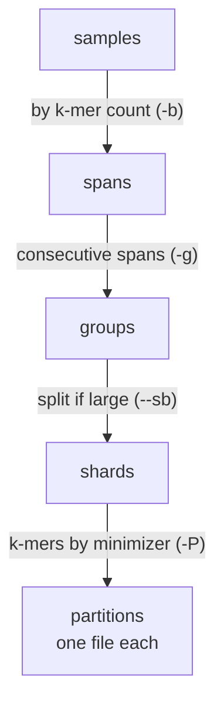

# Glossary

The words used across this documentation, with the names they get in the
[E. coli tutorial](../tutorials/ecoli.md).

## Sequences

| Term | Meaning |
|------|---------|
| **k-mer** | a substring of length `k` of a sequence (`-k`, default 25) |
| **solid k-mer** | a k-mer seen at least twice: in raw reads, a k-mer seen once is likely a sequencing error (see [K-mer counting](kmer-counting.md)) |
| **minimizer** | the smallest sub-word of a k-mer, by a hash order; k-mers sharing a minimizer are stored together, in the same partition |
| **Bloom filter** | a compact bit array telling whether a k-mer belongs to a sample; it can answer "yes" wrongly (a false positive), never "no" wrongly |
| **false-positive rate** | how often a Bloom filter answers "yes" wrongly, set at design (`--fp`, default 0.25); queries lower it to about `fp^z` by looking up longer words (`query -z`, default 6) |

## The index

An index is split two ways: its **samples** are spread over shards, and inside each shard
its **k-mers** are spread over partitions.

| Term | Meaning | In the tutorial | Set by |
|------|---------|-----------------|--------|
| **sample** | one input: a sequence file, or the mate files of one run | `GCA_000780515...` | the input of `design` |
| **span** | a size class of samples, by k-mer count: samples of one span get Bloom filters of the same size | | `-b` (base, default 1.1) |
| **group** | consecutive spans stored together, with the Bloom filter size of their largest span | `coli_g0`, `coli_g1` | `-g` (`0`: chosen, see [profile](../commands/profile.md#description)) |
| **shard** | the samples of a group, or a slice of them when the group is large: stored, queried and updated as one unit. Without sharding, a group is one shard | `coli_g0` (with a shard budget: `coli_g0_p0`, `coli_g0_p1`, ...) | `--sb` (`0`: no sharding, see [compose](../commands/compose.md#description)) |
| **partition** | a slice of the k-mers of a shard, by minimizer: one file per partition in each shard. A query reads only the partitions its k-mers fall into | `coli_g0/matrices/matrix_3.cmbf` | chosen at the first build, then fixed (`-P` to set it) |
| **sub-index** | one kmindex index: a shard, or a chunk before it is merged into its shard | | |
| **index** | the directory holding every shard of an index, and `index.json` listing them: the registry (`BUILD_DIR`) | `coli_build/` | `build -o`, read by `query -r` |

## Building and updating

| Term | Meaning | In the tutorial | Set by |
|------|---------|-----------------|--------|
| **design directory** | what `design` writes: the sample list, the profile, and the index definition | `coli_db/` | `design -o` |
| **layout** | the fixed choices of an index (groups, shards, Bloom sizes, partitions), reused by every update | `coli_db/compose/coli/layout.yaml` | the first `design` |
| **session** | one set of samples added to an index: the first one, then each update | `initial`, `update` | `-s` |
| **part** (task) | the samples a session adds to one shard | `coli_g0_initial`, `coli_g0_update` | `compose` |
| **chunk** | one kmtricks run building some samples of a part; a part too large for one run is built in chunks, then merged | `coli_g0_initial_chunk3` | `--cb`, the open-files limit (see [build](../commands/build.md#shards-and-chunks)) |
| **plan** | every build decision, and the scripts running them, written before anything is built | `coli_build/assets/initial/plan.yaml` | [`plan`](../commands/plan.md) |
| **job** | the unit `apply` runs, and a SLURM task: a shard, some of its chunks, or its merge | `coli_g0`, `coli_g0_j1`, `coli_g0_merge` | `--chunks-per-job` (see [plan](../commands/plan.md#jobs)) |
| **step** | one kmtricks run or one merge, with its status (`SUCCESS`, `FAILED`, ...) | `chunk3`, `merge` | see [apply](../commands/apply.md#progress) |

See [How an index is structured](kmindex-index.md) and [How an index is built](building.md).
