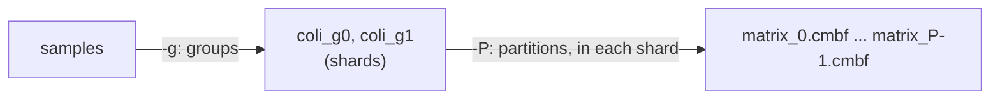

# Choosing groups and partitions

## Two independent settings

The layout of an index rests on two settings (see the [Glossary](terms.md)):

- **groups** (`-g`, [`design`](../commands/design.md), [`profile`](../commands/profile.md)):
  how many sets of samples of similar sizes. Each group gets the Bloom filter size of its
  largest samples, and is stored as one shard (or several, with a shard budget).
- **partitions** (`-P, --partition-count`, hidden option of [`design`](../commands/design.md)
  and [`compose`](../commands/compose.md)): how many files the k-mers of each shard are
  spread over. Usually left unset: the first [`plan`](../commands/plan.md) or
  [`build`](../commands/build.md) sizes it from the resources, then it is fixed for the life
  of the index (see [compose - Partitioning](../commands/compose.md#description)).

By default (`-g 0`), the number of groups is chosen: groups are added while each one saves
at least 20% of the storage; with `design`, an index of at most 4 GB keeps one group (see
[profile - Grouping](../commands/profile.md#description)).

## Summary

Direction to move each setting for a given goal:

| Goal            | Groups (`-g`)  | Partitions (`-P`)  |
|-----------------|:--------------:|:------------------:|
| Faster queries  | -              | -                  |
| Lower build RAM | +              | +                  |
| Less storage    | +              |                    |

`+` increase, `-` decrease, blank: not a practical lever.

For example, to speed up queries, lower `-g` first, then `-P`. If build RAM is
constrained, raise `-P` first, then `-g`.

## Query time

Fewer groups and fewer partitions both mean fewer files read per query: each shard is read
in turn.

## Build RAM

More partitions and more groups both shrink what one build holds at once, lowering its peak
RAM.

## Storage

More groups fit the Bloom filter sizes to the samples more tightly, wasting less space: a
small sample in the group of large ones gets their large filter. The number of partitions
has no meaningful effect on storage. `profile` writes the storage of each choice of groups
to `profile.yaml`, and plots it in `groups.png`.

## Practical trade-off

Fewer groups and partitions favor query speed but raise build RAM; more favor build RAM and
storage but raise the files read per query. Check `groups.png` (from `profile`) before
deciding, and set `-g` explicitly when the automatic choice does not fit your use.
