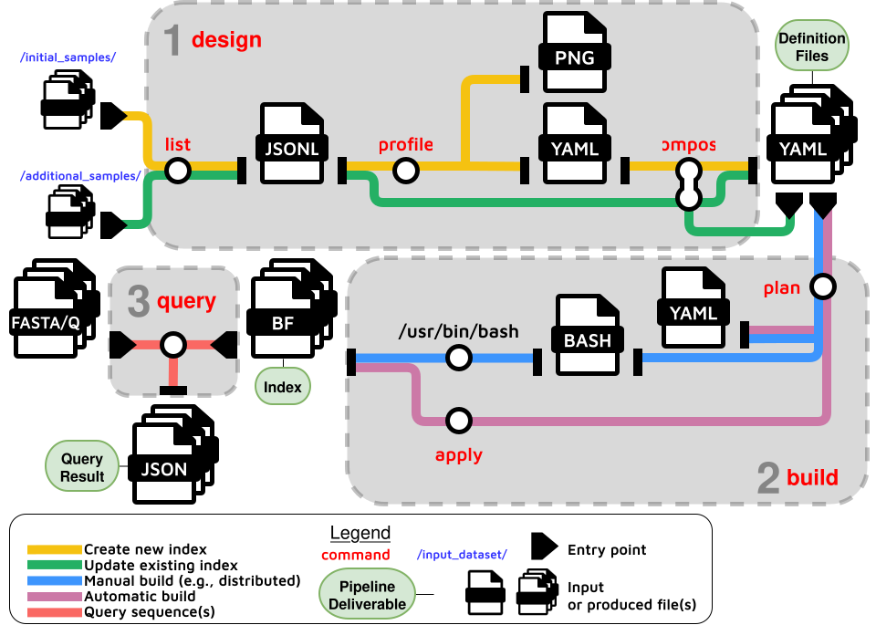

# Quick Start

Once kmhelpers is [installed](installation.md), the fastest way to get hands-on is the [E. coli tutorial](../tutorials/ecoli.md) - it builds a queryable index from real data in three commands. For syntax and options on any command, see the [Command Reference](../commands/index.md).

!!! tip
    `kh` is available as a short alias for `kmhelpers` - both commands are identical.

## The Pipeline

`kmhelpers` exposes the index lifecycle as a sequence of commands, illustrated in figure below:

??? note "Command breakdown"
    - **`list`** - recursively discovers all samples in a given directory and counts each sample's distinct $k$-mers using [**`ntcard`**](https://github.com/BirolLab/ntCard) (unless the counts are provided by the user).
    - **`profile`** - determines the best set of sub-index BF sizes given the user-defined maximum number of sub-indexes and target false-positive rate.
    - **`compose`** - assigns each sample to its sub-index and generates the *files-of-files* describing the data origin of each sub-index.
    - **`plan`** - validates sample files, available disk space, and memory upfront, and emits ready-to-execute pipeline scripts.
    - **`apply`** - builds all sub-indexes by invoking `kmindex`, with span-level and name-level filtering.

    For ease of use, steps `list`, `profile`, and `compose` can be grouped under a single command named **`design`**, and steps `plan` and `apply` can be grouped under the **`build`** command.

    Once an index is built, `kmhelpers` also answers queries (**`query`**). Multi-step workflows can be described as declarative YAML pipelines (**`pipeline`**) and executed in a single command.

    An additional command, **`manage`** *(under development)*, lets users register several distinct indexes (built locally or hosted anywhere accessible) into one logical index, redirecting each query to all registered indexes at query time.



Indices are built and queried in three steps:

```
[1] design → [2] build → [3] query
```

| Step | Command | Purpose | Input | Output |
|---------|---------|---------|---------|---------|
|1| [`design`](../commands/design.md) | Discover samples and generate index definitions | directory or sample list | index definitions |
|2| [`build`](../commands/build.md) | Build k-mer indices from those definitions | index definitions | built k-mer index |
|3| [`query`](../commands/query.md) | Search the indices with FASTA/FASTQ sequences | built index + query sequences | match results |

## Common Use Cases

### Create a new index

!!! abstract ""
    Turn a collection of samples into a searchable index, from nothing.  
    **Input:** your sequence files.  
    **Output:** a queryable index.

Run the pipeline steps against a directory of sequence files (or a plain-text / YAML sample list):

??? example "Commands"
    ```bash
    kmhelpers design /data/sequences -o coli_db/ -n coli
    kmhelpers build coli_db -o coli_build/
    ```

Your index is ready to query:

??? example "Commands"
    ```bash
    kmhelpers query -r coli_build/ -o results/ query.fa
    ```

See the [E. coli tutorial](../tutorials/ecoli.md) for a full walkthrough.

### Update an existing index

!!! abstract ""
    Add new samples to an index you already built, without starting over.  
    **Input:** an existing index, plus the new samples to add.  
    **Output:** the same index, now also containing the new samples.

Re-run `design` with the same `-o`/`-n` and a new sample source, tagging the run with a fresh `-s` session ID:

??? example "Commands"
    ```bash
    kmhelpers design coli_5_update.txt -o coli_db/ -n coli -s update
    kmhelpers build coli_db -s update -o coli_build/
    ```

`design` detects the existing layout file at `coli_db/compose/coli/layout.yaml`, skips the `profile` step, and composes only the new samples. `build` then merges the new samples into the existing index automatically, without recounting the samples already indexed.

!!! warning "Disk space"
    `kmindex` cannot add samples to an existing index in place, so the update merges the previous samples and the new ones into a complete new index, which replaces the previous one in its folder (`coli_build/coli_g0/`). Both versions coexist on disk during the merge, so plan for at least twice the size of the sub-indices being updated.

    The previous version is deleted once the updated one is registered and checked; `--keep-previous` keeps it to compare both - see [`build` - Updating an index](../commands/build.md#updating-an-index).

### Query sequences in an index

!!! abstract ""
    Check whether given sequences are present in your samples.  
    **Input:** a built index, plus the sequences you want to search for.  
    **Output:** for each sequence, which samples it was found in.

Point `query` at a built registry (`-r`) with one or more FASTA/FASTQ files, directories, or stdin:

??? example "Commands"
    ```bash
    # Query the whole index (all sub-indices)
    kmhelpers query -r coli_build/ -o results/ query.fa

    # Query specific sub-indices with multiple threads
    kmhelpers query -r coli_build/ --sh coli_g0 --sh coli_g1 -t 4 -o results/ query.fa

    # Scan a directory of query files, or read from stdin
    kmhelpers query -r coli_build/ -o results/ ./queries_dir/
    cat query.fa | kmhelpers query -r coli_build/ -o results/ -
    ```

See [`query`](../commands/query.md) for batching, output formats, and threshold options.

### Work with large datasets: automatic vs manual build

!!! abstract ""
    Build large indices safely and faster, by checking the work before it runs and spreading it across multiple machines.  
    **Input:** the same index definitions produced by `design` or `compose`.  
    **Output:** the same built index, produced manually step-by-step for more flexibility.


For large sample counts, prefer running [`plan`](../commands/plan.md) and [`apply`](../commands/apply.md) separately instead of `build` (which chains them). `plan` validates all sample paths and writes ready-to-run shell scripts to `OUTPUT_DIR/assets/SESSION/` up front, so path errors surface before any CPU/I/O-intensive building starts:

??? example "Commands"
    ```bash
    kmhelpers plan coli_db -o coli_build/
    ```

**Automatic build**

Review the plan in `coli_build/assets/initial/` (`plan.yaml` and one folder of scripts per shard) and the plan report in `coli_build/logs/` (see [build - Report](../commands/build.md#report)), then:

??? example "Commands"
    ```bash
    kmhelpers apply coli_db -o coli_build/
    ```

**Manual build**

The plan is made of plain bash scripts, in `OUTPUT_DIR/assets/SESSION/<shard>/`: one per kmtricks run (`<part>.sh`, or `<part>_chunk<N>.sh`), then `merge.sh` (check, publish, cleanup). They can be run by hand for a fully hands-on build, runs first, then the merge:

??? example "Commands"
    ```bash
    kmhelpers plan coli_db -o coli_build/
    for shard in coli_build/assets/initial/*/; do
        for run in "$shard"*.sh; do [ "$run" = "${shard}merge.sh" ] || bash "$run"; done
        bash "${shard}merge.sh"
    done
    ```

On a cluster, `plan --cluster cluster.yaml` sizes the plan for the jobs of `cluster.yaml` and writes the SLURM files submitting them, with `--chunks-per-job` to spread the chunks of a shard over several nodes (see [plan - Cluster](../commands/plan.md#cluster)). `apply` runs any subset of the jobs (`--task`: shards or jobs), lists those not done (`--pending`), and can email a notification on completion:

??? example "Commands"
    ```bash
    kmhelpers plan coli_db -o coli_build/ --cluster cluster.yaml
    bash coli_build/assets/initial/slurm/submit.sh

    # or by hand, each node a disjoint subset, emailing when its share is done
    kmhelpers apply coli_db -o coli_build/ --task coli_g0 --notify you@example.com
    kmhelpers apply coli_db -o coli_build/ --task coli_g1 --notify you@example.com
    ```

## Next Steps

- **[Tutorial](../tutorials/ecoli.md)** - a full hands-on walkthrough indexing 10 *E. coli* assemblies
- **[Command Reference](../commands/index.md)** - detailed syntax and options for every command
- **[Choosing Groups and Partitions](../concepts/tuning-groups-partitions.md)** - tune `-g` and `-p` for query time, RAM, or storage